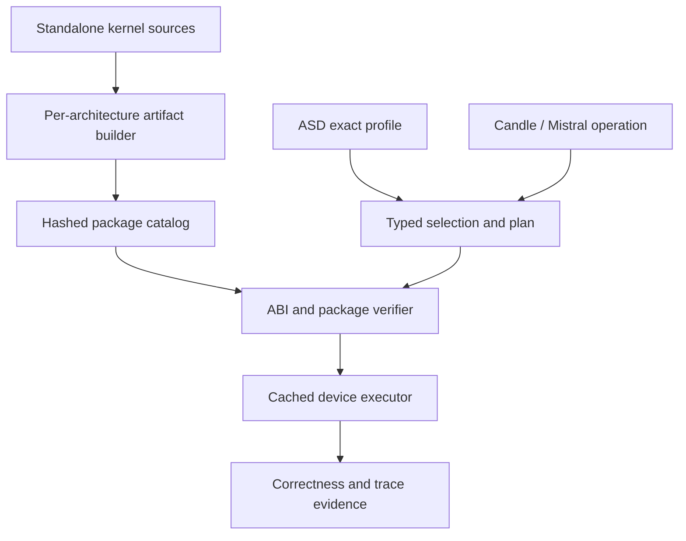

# DKR-R0 — ASD-first Dynamic Kernel Runtime

**Status:** architecture RFC, not an implementation or promotion gate.  
**Branch:** `dynamic-kernel-runtime` in `haricot/mistral.rs`.  
**Evidence base:** [physical SM61 F32 provider A/B/A2 PASS](https://github.com/haricot/mistral.rs/pull/34#issuecomment-6772125988), from the squash-promoted Legacy POC.  
**Target:** a reusable, typed dynamic-kernel substrate across operation families and GPU architectures, before any integration into `extended`.

## 1. Scope and preserved proof

The current `mistralrs-kernel-runtime` is a real CUDA-backed runtime, but only for `mistral.linear.f32.v1`. It validates a content-addressed PTX module, snapshots an exact `ASD-LINEAR-PROFILE-V1` profile, prepares immutable F32 `UnquantLinear` plans, and caches a module for the matching Candle CUDA device. No automatic tuning or live kernel replacement exists yet.

The 2026-11-10 GTX 1080 Max-Q (SM61) run certified CPU/CUDA baseline, A/B/A2 operators and one-layer Llama inference, logits/token parity, missing-decision refusal, post-load removal of profile/manifest/PTX, and constant executable identity. The run reused the old binary and PTX: Cargo and NVCC were not invoked. This **does not** certify quantized providers, performance, other GPU architectures or Extended.

Keep `legacy-provider-poc/f32` and `legacy-provider-poc/inference` **as historical tests until their full contracts and A/B/A2 regressions have migrated**. Do not remove the only executable proof or change the stable F32 ABI prematurely. After replacement gates pass, historical examples can move to a test/archive location or be removed in a separate reviewed change.

## 2. Architecture boundary



| Responsibility | Owner | Invariant |
| --- | --- | --- |
| Operator semantics, dtypes, layouts, shape and numerical contract | Versioned **operation ABI** | A new pointer or scale layout requires a new ABI/adapter; do not reinterpret an old one |
| GPU-specific implementation and launch metadata | Standalone **kernel package** | SM61 code lives outside the Rust host build, hashed by content |
| Selection policy | **ASD** profile/selector | Exact decisions, explicit fallback policy, immutable prepared snapshot |
| CUDA loading, stream, memory, bounds, module lifetime | `mistralrs-kernel-runtime` | Same Candle CUDA context/stream, bounded resources, cached immutable modules |
| Mistral/Candle bridge | Thin typed adapter(s) | No dependency cycle and no second hidden dispatcher |
| Qualification and promotion | CI orchestrator + physical SM61 gate | Full binary/artifact/profile identities and numeric evidence, never a cache hit alone |

`mistralrs-kernel-runtime` initially owns the Rust verifier/loader and the Mistral adapter. Reusable Candle operation adapters should live on the appropriate Candle side or in a dependency-neutral contract layer; Candle must **not** depend on Mistral.rs just to execute a kernel.

## 3. Separate host binary, architecture packages and ASD decisions

Suggested destination (not yet created):

```text
mistralrs-kernel-runtime/
  src/
    abi/                 # versioned, typed operator contracts
    catalog/             # package resolution and integrity
    selection/           # ASD exact-key adapter, immutable layer plans
    cuda/                # device/stream execution, resource guards, cache
    evidence/            # identity, submission and runtime trace
kernel-packages/
  sm61/
    linear/
    quant-gemm-gemv/
    moe/
    convolution/
    attention/           # only after an independently reviewed ABI
  other-architectures/   # introduced only after separate qualification
docs/
  DYNAMIC_KERNEL_RUNTIME_R0.md
```

Do not put CUDA source selection, card-specific `match cc` blocks or kernel implementation choices inside Mistral model code. The host must understand only a small set of **typed** ABI families and runtime contracts; the artifact catalog supplies the variant.

A proposed package v2 includes: operation ABI and schema version; implementation ID; target/min/max compute capability; PTX entry and SHA-256; dtype/layout/quant-scale descriptors; launch contract and resource limits; source/toolchain/recipe hashes; qualification status and proof references. Versioning and structure here are **proposals**; the currently implemented F32 `module.json` schema 1 remains authoritative.

A hash proves content identity, **not publisher authenticity or correctness**. Trusted package provenance/signatures and strict path, size, pointer, device, stream, shape and resource checks remain mandatory.

## 4. ASD integration

The existing F32 adapter accepts `ASD-LINEAR-PROFILE-V1` with `purpose=validation_only` and exact `[M,N,K]` keys. It must remain compatible during migration.

Propose a **generic, typed ASD selection layer** with separate operation adapters, not a single unsafe “call any PTX function” signature:

- Key: operation ABI/version, dtype and quantization format, `M/N/K` or operation-specific dimensions, stride/layout/alignment, architecture and required features; distinguish prefill and decode.
- Value: selected content-addressed package/entry, launch parameters validated against its ABI, numerical tolerance contract and allowed fallback policy.
- Preparation: resolve and validate package and exact decisions once, before the first request; pin the profile generation and modules for that model/session.
- Runtime: no filesystem reads, retuning or environment lookups on the hot path. Module cache is tied to CUDA context/device, artifact SHA-256, ABI and launch contract.
- Failure: selected or required exact decisions **fail closed** when missing; native fallbacks are permitted only when **explicitly declared**, never as a silent way to pass certification.
- Promotion: experimental profiles do not become production ASD recommendations until numerical and physical hardware gates pass.

Do not parse or overwrite Candle's existing convolution ASD wire format as if it were this F32 schema. Introduce a carefully versioned adapter/migration with fixtures for both families.

## 5. SM61-first operation families

| Priority | Operation families / standalone sources | Initial requirement |
| --- | --- | --- |
| P0 — proven | F32 dense `UnquantLinear` A/B/A2 | Keep the existing ABI and replay proofs exactly |
| P1 | F16/BF16-emulation, FP8 SIMT/DP4A, FP4 NVFP4/MXFP4 emulation; GEMV/GEMM, prefill/decode | Separate quant/scale/layout ABIs; parity against a reference, no native SM61 BF16/FP8/FP4 claim |
| P2 | ASD-convolution exact candidates and GEMM tiling | Reuse the same catalog and qualification identity; preserve operation-specific semantics |
| P3 | CUDA SIMT MoE and expert-cache paths | Define stream/event and expert residency contracts; CPU expert-cache scheduling remains a separate host path |
| P4 | cuDNN/native fallback and attention/paged families | Opt in only after typed contracts and independently qualified fallbacks |
| P5 | Additional GPUs | New per-architecture packages and physical tests; never infer portability from SM61 |

A single profile may select different packages by shape/phase/architecture. Multiple candidates can share an opaque implementation name only if their **artifact/entry identities** distinguish them.

## 6. Build and qualification cache keys

Separate three kinds of identity:

1. **Host build key:** Rust sources, Cargo.lock, features, target/triple, Rust toolchain, Candle revision and host SDK/ABI. Rebuild the host only when this key changes.
2. **Kernel artifact key:** standalone CUDA source and includes, ABI, target SM, compiler/toolchain and flags, output PTX/cubin hashes. Rebuild only that package when this key changes.
3. **Qualification key:** host binary SHA, artifact and manifest SHA, exact ASD profile SHA, fixture/model SHA, device CC/UUID, CUDA driver/runtime, test recipe and numerical report hashes. A cache entry is **not** itself a PASS result.

The R0 contract is **one SM61 host build per unchanged environment**, no multi-architecture rebuild for the user's Pascal campaign, and reuse of the same executable for A/B/A2 and profile-JSON-only fixes. CI should prefer `cargo nextest` where applicable, retain immutable build caches keyed by the full recipe, and upload reports with machine-readable provenance. Never use obsolete one-off compiler variables as a prerequisite for evidence replay.

## 7. Promotion gates, in order

- **R0 — existing proof:** F32 A/B/A2 physical SM61 PASS, fail-closed negative case, binary/PTX hashes unchanged (done). The ten full JSON reports are still operator-local; the PR holds only their summary/identities.
- **R1 — catalog/ABI:** schema/versioned typed lookup with negative security and malformed-manifest tests; legacy F32 adapter remains numerically and behaviorally identical.
- **R2 — multi-operation SM61:** one new quantized family at a time, with exact tensor/scale/layout parity and no fallback, then convolution/MoE as separate lots.
- **R3 — hot-path and caching:** prove no filesystem/tuner calls during inference; device/context isolation, thread safety, cache reuse, safe module lifetime and explicit asynchronous events.
- **R4 — performance qualification:** paired A/B/A2 GPU measurements, precision/latency/memory budgets and traceable package promotion. Numerical correctness is a prerequisite, not a performance result.
- **R5 — integration candidates:** validate Legacy and Extended compositions independently against their pinned Candle candidate/lock; do not merge `dynamic-kernel-runtime` blindly into `extended`. Follow the existing [CI orchestrator topology](https://github.com/haricot/ci-orchestrator/blob/main/docs/CANDLE_UNIFIED_R4.md) and preserve rollback.

**No Extended promotion until R1–R3 are complete for the intended operation families and the relevant physical gates are green.** Later feature groups may require a new host ABI and therefore a deliberate single host rebuild; dynamic PTX cannot eliminate this boundary.

## 8. Open design decisions before a major Rust refactor

1. Should the versioned, dependency-neutral ABI catalog eventually be shared with Candle, or remain Mistral-owned with Candle adapters? Do not introduce a Candle→Mistral dependency.
2. Which ASD profile/store owns production promotion and rollback? Define one authoritative selector, not parallel hidden dispatchers.
3. Which untrusted package signing/provenance policy and permitted deployment sources are required?
4. How is a profile generation swapped? R0 uses process restart; in-process switching needs a quiescence barrier and module lifetime tests.

This RFC is the starting point for review. **It intentionally changes no runtime execution path** and preserves the independently proven F32 reference until a generic replacement clears the same physical SM61 gates.
